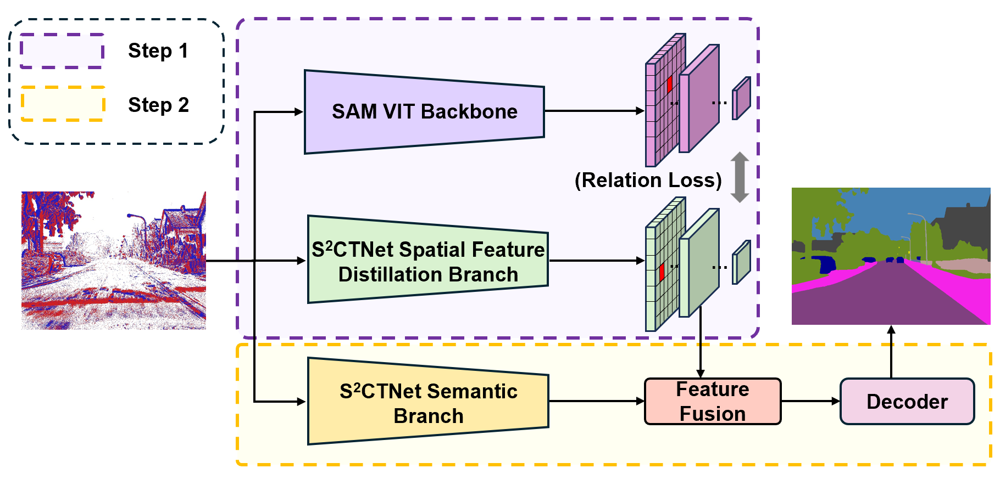

# S2CTNet-SAM-guided-Semantic-Conv-Transformer-Network-for-Event-Segmentation

   

We propose a joint cross-modal and cross-model distillation framework for event-based semantic segmentation. Using SAM as a teacher, we distill multi-level RGB spatial features into an event backbone via feature-level alignment, enabling effective knowledge transfer from vision foundation models to event-based systems.

We will release the code upon acceptance.

